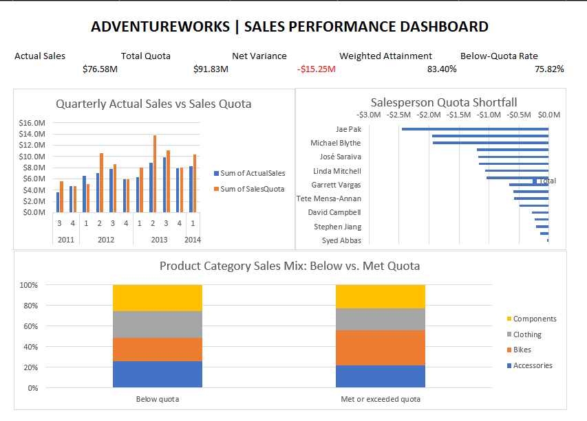

# AdventureWorks Sales Performance Analysis

## Project Overview

Analyzed salesperson sales performance against quota using SQL Server and Excel. The project evaluates quarterly quota attainment, identifies cumulative salesperson shortfalls, and compares product-category sales mix across below-quota and quota-met periods.

## Business Questions

- How closely did salespeople achieve their assigned sales quotas?
- Which salespeople had the largest cumulative quota shortfalls?
- How did quarterly sales compare with quota over time?
- Did product-category sales mix differ between below-quota and quota-met periods?

## Tools and Technologies

- **SQL Server:** Joins, CTEs, aggregations, window functions and data validation.
- **Microsoft Excel:** XLOOKUP, SUMIFS, COUNTIFS, IFERROR, PivotTables, PivotCharts and dashboard design.

## Key Findings

- Comparable-period actual sales totaled approximately **$76.58 million**, against **$91.83 million** in quota.
- Weighted quota attainment was **83.40%**, with a cumulative shortfall of approximately **$15.25 million**.
- **75.82%** of comparable salesperson-quarter observations were below quota.
- Jae Pak had the largest cumulative shortfall among the salespeople analyzed, at approximately **$2.45 million**.
- Bikes represented a larger share of sales during quota-met periods, while Components represented a larger share during below-quota periods. These are descriptive differences and do not establish causation.

## Dashboard

The dashboard summarizes quarterly sales versus quota, salesperson shortfalls, and product-category sales mix.

## Methodology

1. Extracted salesperson, quota, sales-order, product, category and territory information from AdventureWorks2022.
2. Aggregated attributed sales using order-detail `LineTotal`.
3. Combined quarterly salesperson sales with quota history to evaluate attainment and variance.
4. Validated sales totals and flagged unusual quota changes for review.
5. Exported the SQL results to Excel, validated names with XLOOKUP, recalculated summary metrics with SUMIFS and COUNTIFS, and built PivotTables, PivotCharts and the final dashboard.

## Data Quality and Limitations

- Q2 2011 was excluded from comparable quota analysis because the sales history for that quarter was incomplete.
- Sales periods without a quota record were not treated as comparable quota periods.
- Unusual quota changes were flagged for review; source quota values were not changed.
- Quota history dates were mapped to calendar quarters for this analysis. The intended business-period mapping should be confirmed before production use.
- Territory analysis used the salesperson's assigned territory, which may not represent historical territory assignments.
- Differences in category sales mix do not prove that a category caused a quota shortfall.

## Repository Contents

- `sql/`: SQL analysis, output queries and validation checks.
- `excel/`: Final Excel workbook and dashboard.
- `data/processed/`: Exported analysis datasets.
- `images/`: Dashboard screenshot.
- `docs/`: Methodology and data dictionary.

## How to Reproduce

1. Restore AdventureWorks2022 in SQL Server.
2. Run the SQL scripts in `sql/` in the documented order.
3. Export the query results to the CSV files under `data/processed/`.
4. Open the Excel workbook in `excel/` to inspect the dashboard and supporting analyses.